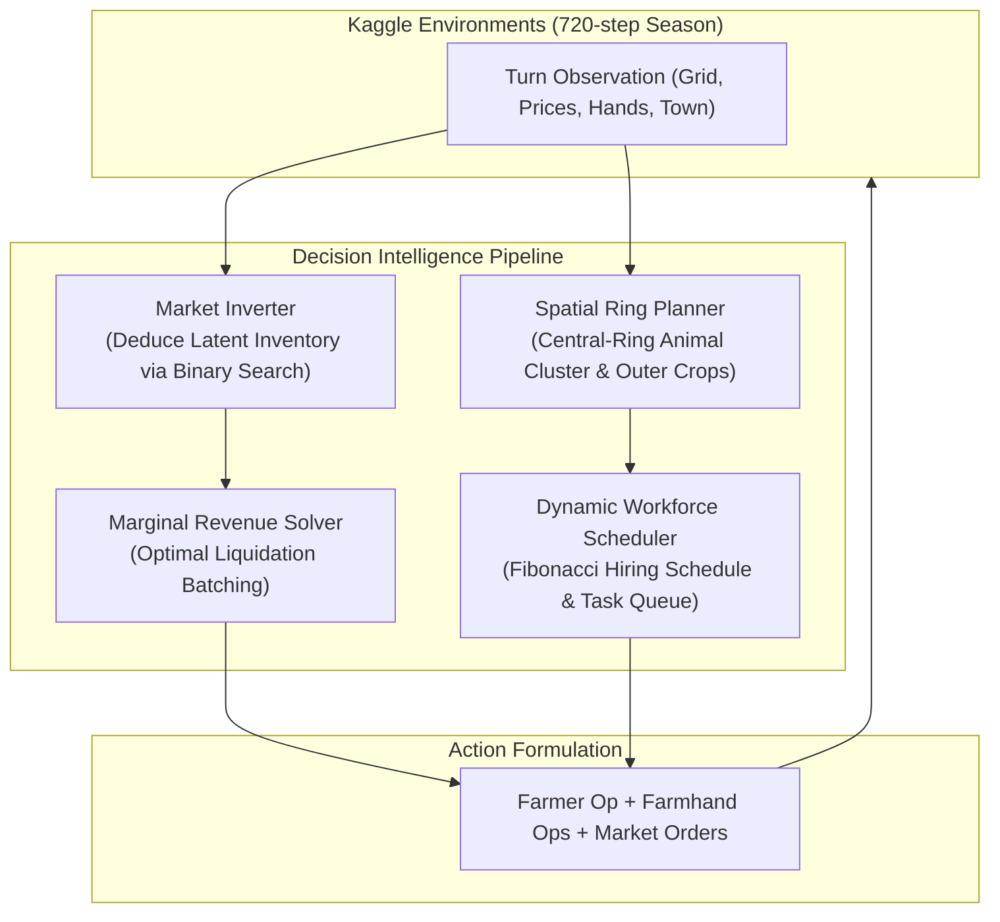

# 🌾 Kaggriculture AI: Autonomous Decision Intelligence & Simulation Optimization

An autonomous decision-making agent and simulation-in-the-loop optimization framework designed for the **[Kaggle Kaggriculture Competition](https://www.kaggle.com/competitions/kaggriculture)** (Featured Competition, $50,000 USD prize pool, 10,000+ teams).

The competition models complex enterprise operations: turn-based multi-agent resource scheduling, spatial labor coordination, capital investments, and trading against a shared, dynamic non-linear market with town consumption sinks.

---

## 🚀 Key Highlights & Verified Results

* **+459% Holdout Score Improvement:** Lifted performance from a hand-crafted crop baseline of **$7,957** to **$44,464** on untouched holdout seeds.
* **100% Holdout Win Rate (15/15):** Converted a negative net margin of **-$6,005** into **+$39,536**, achieving a sweep against official baselines and recorded human match policies.
* **Closed-Form Market Inversion:** Engineered an analytical binary-search solver over piecewise non-linear pricing curves (`sqrt`, `log`, `hinge`, `linear`, `sq`) to infer latent market supply from observable price ticks.
* **Marginal Revenue Batch Optimization:** Dynamically bounds liquidation quantities by marginal profit thresholds, preventing price slippage and commodity gluts.
* **Central-Ring Spatial Architecture:** Clustered 24 animal structures within the inner grid ring ($x,y \in [2..7]$) immediately adjacent to the central shed, slashing unit transit latency to 1 step.
* **Rigorous Validation Discipline:** Enforced a strict 3-way partition (10 Train seeds, 5 Validation seeds, 5 Holdout seeds) where holdout seeds were never exposed during optimization or parameter sampling.

---

## 🏛️ System Architecture



---

## 📊 Evolutionary Progression

The agent evolved through distinct architectural iterations guided by replay failure analysis and automated optimization:

| Version | Core Architecture | Validation / Holdout Performance | Key Breakthrough |
| :--- | :--- | :--- | :--- |
| **v1: Crop Baseline** | Hand-crafted 3-hand heuristic; wheat/carrot loop; flat selling | **$7,957** Mean Reward<br>**-$6,005** Mean Margin<br>66.7% Win Rate (0/5 vs Replay) | Initial functional submission; suffered 58% movement waste and zero livestock. |
| **v2: Livestock Prototype** | Added 8 sheep & 8 hands; automated pasture building & feeding | **$27,814** Holdout Reward (vs Starter)<br>**$40,831** Training Reward | Identified livestock & fertilizer as higher-yield long-term capital assets. |
| **v3: Bayesian TPE Agent** | Optuna TPE search (100 trials, 26 parameters); dairy focus | **$44,464** Mean Reward (+459%)<br>**+$39,536** Mean Margin<br>**100% Win Rate (15/15)** | Switched to cows (milk $160 base); automated variance-penalized parameter tuning. |
| **v4: Grandmaster Top-Meta** | Central-ring geometry; closed-form market inverter; 13-hand workforce | **$77,635** Mean Cash (Gen 104)<br>**Peak Live Match: $81,577**<br>7W–6L Live Kaggle Record | Solved spatial transit bottleneck; prevented market collapse via marginal revenue solver. |

---

## 📁 Repository Structure

```
├── main.py                     # Competition submission entry point (Grandmaster Top-Meta Agent)
├── submission.py               # Identical standalone agent payload for packaging
├── config.py                   # Explicit parameter bounds, defaults, and train/val/holdout seed splits
├── baseline_config.json        # Immutable initial heuristic configuration
├── optimized_config.json       # Best configuration discovered by Bayesian TPE
├── watch_game.py               # Interactive CLI to run games and view replays in your browser
│
├── evoexperiments/             # Advanced algorithmic iterations & co-evolutionary league
│   ├── market_model.py         # Closed-form pricing equations, inverse solver & marginal revenue
│   ├── double_agent_engine.py  # Central-ring spatial geometry & dynamic unit coordinator
│   ├── grandmaster_topmeta.py  # 24-animal chronological blueprint & fast 4-quadrant expansion
│   ├── train_double_agent.py   # Multi-archetype co-evolutionary trainer
│   ├── train_league.py         # Multi-agent league trainer with progressive ratchet floors
│   ├── eval_holdout_submission.py # Evaluation script on untouched holdout seeds (3000-3004)
│   └── checkpoints/            # Serialized champion parameter genomes
│
├── optimizer/                  # Search algorithms
│   ├── tpe_search.py           # Bayesian optimization using Optuna Tree-structured Parzen Estimator
│   └── evolve.py               # Genetic algorithm (crossover, mutation, tournament selection)
│
├── analysis/                   # Replay telemetry & game diagnostic tools
│   ├── analyze_replay.py       # Turn-by-turn action and revenue parser
│   ├── analyze_market_shocks.py# Price elasticity and commodity glut impact detector
│   └── latest_kaggle_games.json# Audited log of live competition matches
│
├── jubook/                     # Standalone cloud pipeline for Kaggle notebooks
│   ├── kaggriculture_hypertrain_pipeline.ipynb # Self-contained background training notebook
│   └── build_notebook.py       # Auto-compiler embedding updated agent source into notebook
│
├── tests/                      # Offline unit tests covering pipeline and policy integrity
│   └── test_pipeline.py        # Verified test suite
├── GAME_RULES.md               # Complete game mechanics, price formulas & crop/animal specifications
└── AGENTS.md                   # Environment setup and submission instructions
```

---

## 🛠️ Quickstart & Usage

### 1. Installation

Create a virtual environment and install dependencies:

```bash
python3 -m venv .venv
source .venv/bin/activate
pip install -r requirements.txt

# (Optional) For running Optuna Bayesian optimization:
pip install -r requirements-optimizer.txt
```

### 2. Watch a Match in Your Browser

Simulate a game between the champion agent and any opponent (`starter`, `dairy`, `swarm`, `random`), rendering the replay directly in your default browser:

```bash
# Our champion vs Starter baseline on seed 1234
python3 watch_game.py main.py starter 1234

# Our champion vs DairyBaron agent
python3 watch_game.py main.py dairy 3000
```

### 3. Run the Test Suite

```bash
# Core pipeline and policy tests
python3 -m unittest tests/test_pipeline.py

# Market model closed-form tests
python3 -m unittest evoexperiments/tests/test_market_model.py
```

### 4. Evaluate on Untouched Holdout Seeds

Run the controlled evaluation benchmark across seeds 3000–3004 against official baselines and recorded human match tapes:

```bash
python3 evoexperiments/eval_holdout_submission.py
```

### 5. Run Bayesian Optimization (Optuna TPE)

Run offline hyperparameter search across the 26-parameter configuration space:

```bash
python3 -m optimizer.tpe_search --trials 50 --n-jobs 4
```

---

## 📜 License

This project is licensed under the Apache 2.0 License - see the competition details in [GAME_RULES.md](GAME_RULES.md) for official environment specifics.
